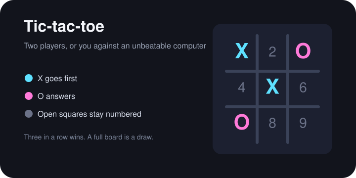
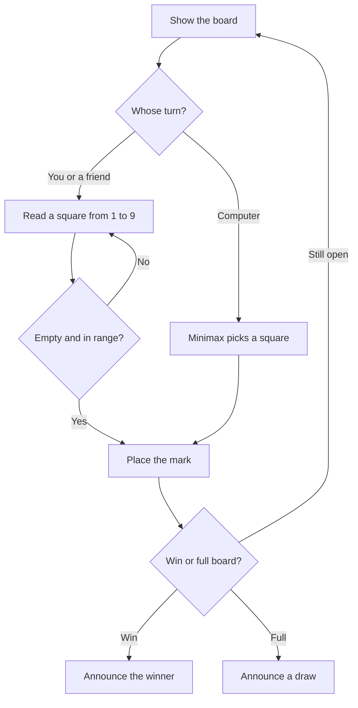

# Tic-tac-toe

A small terminal game. Play a friend on the same keyboard, or play the computer. The computer searches every future board with minimax, so a careful game against it ends in a draw.



| | |
| --- | --- |
| Language | Python 3.9 or newer |
| Players | Two people, or you versus the computer |
| Marks | **X** plays first. **O** answers. |
| Input | Square numbers `1` through `9` |

## Play

From this folder:

```powershell
python tictactoe.py
```

The first prompt asks whether you want the computer. Press Enter to play it, or type `n` for two players. After a game, press Enter to play again or type `n` to quit.

Empty squares show their numbers. Taken squares show **X** in cyan and **O** in magenta. Invalid numbers and occupied squares are rejected, and the turn stays with the same player.

```text
 X | 2 | O
---+---+---
 4 | X | 6
---+---+---
 O | 8 | 9
```

Set `NO_COLOR=1` if you want plain text with no ANSI colors. Colors also stay off when output is piped.

## Rules

1. X starts. Players alternate.
2. A move claims one empty square.
3. Three matching marks in a row, column, or diagonal wins.
4. A board with no empty squares and no three-in-a-row is a draw.

Against the computer you are X and the computer is O.

## How a turn works



The computer scores a win as better when it happens sooner, and a loss as worse when it happens sooner. Equal scores fall through to a draw. From an empty board, perfect play on both sides always draws.

## Files

| File | What it is |
| --- | --- |
| `tictactoe.py` | The game: board, input, colored display, and the computer |
| `assets/board.svg` | The picture at the top of this page |
| `README.md` | This guide |
